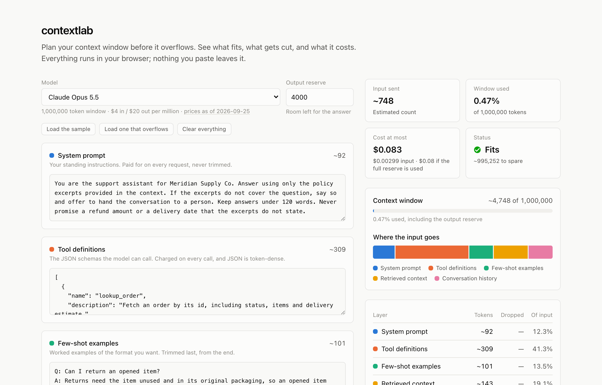
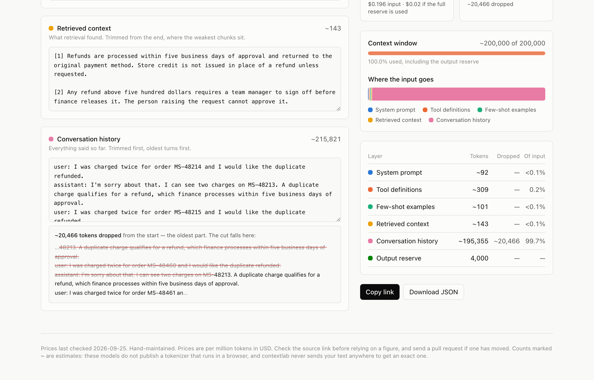

# contextlab

**Plan your context window before it overflows.** See what fits, what gets cut, and what it
costs — before you send anything.

[](https://github.com/mohsinaliwork686-rgb/contextlab/actions/workflows/ci.yml)
[](LICENSE)

**Try it:** https://mohsinaliwork686-rgb.github.io/contextlab/



---

## The problem

A context window is a budget, and almost nobody treats it like one.

"The prompt" feels like one thing. It is really a stack, and every layer spends from the same
allowance: the system prompt, the tool definitions, the few-shot examples, whatever retrieval
returned, the conversation so far, and the room the answer needs.

The failure is quiet. Nothing errors with "your request was 4,000 tokens too big". The answer
is just slightly worse than yesterday's, because a framework silently dropped the oldest turns,
or cut the last retrieved chunk off mid-sentence. Quality slips and nothing in the logs says why.

Then there is cost. Input and output are priced separately, often five times apart, so a long
prompt with a short answer and a short prompt with a long one cost very different amounts.

## What it does

Paste each layer into its own box. contextlab shows:

- **How full the window is**, against the chosen model's real limit
- **Which layer is spending it** — one colour per layer, scaled to the input
- **What the request costs at most** — input and output priced separately
- **What gets cut, and exactly where** — when a request overflows

That last one is the point. Being told you are 20,000 tokens over is mildly useful. Seeing the
exact sentence where the cut lands is what lets you fix it:



Every view has a link that reproduces it, so a budget problem can be shared with a teammate.

## What the sample request shows

The sample is a small support-bot request. Its biggest single cost is not the instructions or
the retrieved documents: it is the **two tool definitions, at 41% of the input**.

That is not a quirk of the sample. JSON is dense with punctuation, and punctuation tokenises
badly: in contextlab's estimates it comes out at roughly 1.9 characters per token, against about
3.3 for ordinary prose. So a tool schema costs close to twice as much as text of the same length
— and it is charged on every single request. It is the layer people forget to count.

## How trimming works

When a request does not fit, layers are trimmed in this order, the way real frameworks do it:

| Order | Layer | Cut from | Why |
|------:|-------|----------|-----|
| 1 | Conversation history | the start | the oldest turns are the ones you can lose |
| 2 | Retrieved context | the end | chunks arrive ranked, so the last are the weakest |
| 3 | Few-shot examples | the end | the later examples add the least |
| — | System prompt, tools | never | dropping them changes what the model *is* |

If the system prompt and tool definitions do not fit on their own, contextlab says so plainly
rather than pretending trimming can help.

## On honest numbers

The models listed do not publish a tokenizer that runs in a browser. Their exact counts come
from the vendor's API — and contextlab will not send your text anywhere to get one. So every
count is an estimate, and **the page says so**: estimates wear a `~`.

The estimator handles the cases where "four characters per token" breaks down: digits, code,
JSON, and Chinese, Japanese and Korean text all tokenise very differently from English prose.
It also errs slightly high on prose. For a budget, that is the safe direction: planning for
more than you spend leaves room, while planning for less gets cut off.

## Prices

Model prices live in one file, [`src/lib/models.data.json`](src/lib/models.data.json), with the
date they were last checked and a source link for every entry. Prices change, so **a pull
request updating them is welcome**, as is one adding another vendor's models.

The file is validated when the app builds, so a bad edit fails the build rather than putting
`NaN` in the cost column.

## Run it

```bash
npm install
npm run dev          # http://localhost:3000
```

```bash
npm test             # unit tests for the logic
npm run build        # static export into out/
npm run e2e          # browser tests against that build
```

## How it is built

All the logic lives in `src/lib/` as plain TypeScript, with no React in it. The components
only display what it returns. That is why the logic can be tested thoroughly without a browser,
and the browser tests only need to prove the page is wired up.

| Module | Job |
|--------|-----|
| `budget.ts` | Takes the layers and a model, works out what fits, what is trimmed and where |
| `tokenizer.ts` | Estimates tokens, with separate handling for digits, CJK text and emoji |
| `cost.ts` | Prices input and output separately |
| `models.ts` | Loads and validates the model and price table |
| `share.ts` | Compresses the page state into a link and reads it back safely |

The app is a static export: plain files, no server, no database, no accounts. The design
decisions and why they were made are in
[`docs/IMPLEMENTATION_PLAN.md`](docs/IMPLEMENTATION_PLAN.md).

## Non-goals

- **It never calls a model.** No API keys, no network, no cost to use.
- **No accounts, no saved history.** A link is the only persistence.
- **It is not a tokenizer explorer.** Good ones exist. Counts here serve the budget.
- **It does not rewrite your prompt.** It shows you the budget. What to cut is your call.

## License

MIT — see [LICENSE](LICENSE).
